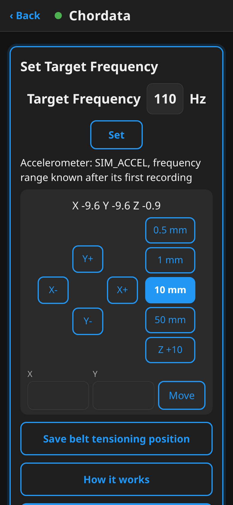
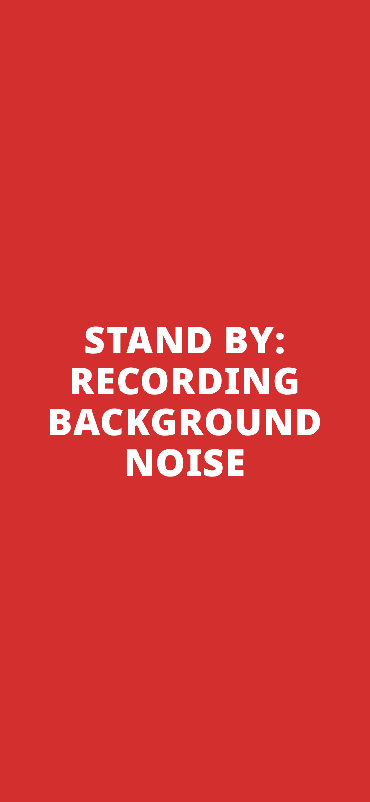
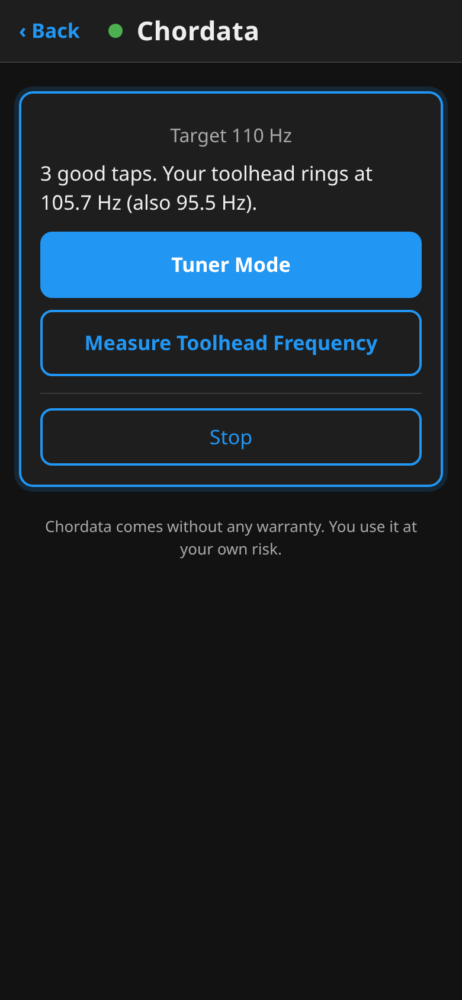

# Chordata

Accelerometer based belt tension measuring for Kalico and Klipper.

Pluck a belt like a guitar string. The accelerometer on the toolhead hears it, and Chordata shows the belt's
frequency, so you can tension both CoreXY belts to the same, known value. No phone app, no holding a microphone
next to the belt: the sensor is already on the printer, and you keep both hands free.

## How it works

Chordata is a page on your printer, made for a phone held next to it. The screens below are from a
virtual printer, so the numbers are made up; the page is the real one.



**1. Set up.** Enter the target frequency your printer's documentation gives and park the toolhead where it
says to pluck (the jog pad moves it; the position can be saved for next time). Press **Start**.



**2. Hands off.** The screen turns red for a moment while Chordata records the background (fans, motors),
so it can tell a pluck from what is always there.


**3. Tap.** The screen turns yellow: tap one solid spot on the toolhead lightly until 3 taps count (each
shows a check mark or an X). Chordata learns how the toolhead rings by itself: at which frequencies, how
long and how broad each line is. Toolheads differ a lot (a plastic one rings briefly in broad lines, a stiff
all-metal one rings long in sharp lines), so each line is guarded as wide as it is. A line the tap set
ringing on a belt is never learned as the toolhead's, nor is a knock's impulse. The taps can't be skipped:
the belts are only measured once 3 good taps were heard (or 3 taps that show a stiff toolhead with
nothing to learn).



Then the card shows the toolhead's note and the **Tuner Mode** button.


**4. Tune (Tuner Mode).** The screen turns green: pluck either belt. The stream is analysed as it comes, so
each clear pluck shows its frequency within about a second, how far it is from your target and which way
to turn. A weak pluck or a knock is left out, greyed in the history with why. A knock is told from a pluck
by physics: a plucked belt pulls on the toolhead twice per swing, a knock doesn't, so an event whose line at twice
the tone is missing or far under its tone is left out. Under the number: the
average of the last plucks that agree (up to 5, within 1 Hz of each other), and from 4 such plucks a
**± Hz per pluck** from their scatter. Turn the tensioner a little between plucks until the belt is on
target (within 0.25 Hz; the last pluck decides, the average under it shows whether that holds), then do the
other belt. A listen ends 60 s after the last pluck, or after 30 minutes at most; start it again to go on.


**5. Match.** CoreXY belts pull on each other, so turning one moves the other a little: pluck both once
more at the end. Done when both are on target, and so match each other. After **Done**, the card keeps the
last pluck, the average and the whole history.

The page keeps a history of the session's plucks, newest at the top. **Reset history** starts it over, and
so does a **double tap** on the toolhead (two taps up to 0.8 s apart), so you can start over without
touching the phone.

If a fan hums on the belt's note, Chordata says so and offers to turn it off for the measurement, but only
fans you have **allowed** (the card asks once per fan, and the choice is kept). Fans it recognises as cooling
the hotend, the stepper drivers or the electronics are never offered. Fans it turned off come back on when
you close Chordata, when a print starts, or after 10 idle minutes.

Where to put the toolhead, which stretch of belt to pluck and the target frequency all come from your
printer's own documentation. Chordata can save the toolhead position for next time.

The **[user guide](docs/USER_GUIDE.md)** walks through setup and a full measurement; the
**[troubleshooting guide](docs/TROUBLESHOOTING.md)** helps when something fails.

## Requirements

- A Raspberry Pi Zero 2 W or faster host (a real Pi 5 keeps up with Tuner Mode, and so did the Zero 2 W,
  3B and 4B in tests on emulated Pis; the original Pi Zero is not supported)
- Kalico or mainline Klipper, Moonraker, and Mainsail or Fluidd
- An accelerometer on the toolhead (ADXL345, LIS2DW, a probe with one built in) and `[resonance_tester]`
- `[respond]` in printer.cfg, and numpy in the Klipper Python environment (input shaper needs it too)
- A CoreXY printer (two belts that must match)

## Install

```
cd ~ && git clone https://github.com/HydrateFrequently/Chordata.git
~/Chordata/install.sh
sudo systemctl restart moonraker klipper
```

The installer links the plugin into Klipper (`klippy/extras`, or Kalico's `klippy/plugins`), adds
`[include chordata.cfg]` and `[include chordata_settings.cfg]` at the top of printer.cfg (with a backup), and
an update entry for Mainsail's update manager. It also adds the **Chordata page**, served by Moonraker (a small
component, `[chordata_web]`), with a link in Mainsail's sidebar. Open it on a phone at
`http://<printer>/server/chordata` and lay the phone near the printer: it shows big signal-colour cards for what
your hands do, each pluck live in big numbers against the target, and a pad to move the toolhead to
your belt tensioning position. The screen stays on while the page is open. On a PC the page looks like Mainsail's
own pop-ups. The same steps also run as prompts from the **CHORDATA** macro in Mainsail or Fluidd.

Settings (`chordata_settings.cfg`): `belt_target` (Hz, default 110; you can also change it on the first prompt)
and `belt_tolerance` (Hz, default 0.25). The fans you allowed Chordata to turn off are kept in
`chordata/fans_ok.json` in the config folder (delete it to take them all back). The latest 5 recordings (`recordings_keep` in `[chordata]`)
are kept in `chordata/recordings/` in the config folder, written there when you close Chordata, so you can
download them from Mainsail. `CHORDATA_RECORD SECONDS=10 NAME=test` records any accelerometer
(`CHIP=` as in Klipper's own commands) into the same folder.

## Update

Mainsail's (or Fluidd's) update manager shows Chordata next to Klipper and Moonraker; update it there. By hand:
`cd ~/Chordata && git pull && ./install.sh`, then restart Moonraker and Klipper.

## Uninstall

```
~/Chordata/uninstall.sh
sudo systemctl restart moonraker klipper
rm -rf ~/Chordata
```

The uninstaller removes the plugin links, the two includes in printer.cfg, the Chordata page and the update entry
in moonraker.conf, and the sidebar link, backing up each file it changes (`*.before-chordata-uninstall`). Your
`chordata_settings.cfg` and the recordings in `chordata/` stay; delete them by hand if you don't want them.

## How it was tested

Chordata has been checked against a microphone on two CoreXY printers so far.

- **The author's printer** (Kalico, with both a Beacon and an NH36 toolhead board with an ADXL345 on the
  extruder; a Zoom H5 recorder with the XYH-5 microphone as the reference, read over the same stretch of each
  pluck as Chordata reads):
  - In two short recordings per sensor (about 7 plucks per belt), each belt's average agreed with the
    microphone within 0.21 Hz, and the difference between the two belts (what tensioning matches) within
    0.16 Hz.
  - In five Tuner Mode sessions with the real-time engine, 293 plucks were counted and 206 of them had a
    clear microphone reading: 56 % of those read within 0.25 Hz of the microphone and 64 % within 0.5 Hz.
    No toolhead tap was counted as a pluck. One belt reads about 0.6 Hz above the microphone; the cause is
    not known yet.
  - The same recordings replayed through the whole plugin on a virtual printer gave the same counts, and
    readings within 0.02 Hz, as the engine run on them directly.
  - The belt module first ran on this printer as part of Printune, measuring both belts. Chordata now runs
    there as a standalone plugin, where Tuner Mode, the history, Reset and the double tap were tried out.
- **Battlefield_Ace's printer** (ADXL345 on the toolhead, with an audio recording of the same plucks as the
  reference): all 38 plucks were counted and no tap was. On one belt (about 84 Hz), 16 of 20 plucks read
  within 0.25 Hz of the audio and 18 within 0.5 Hz. The other belt (about 92 Hz) reads 0.7 to 1.0 Hz above
  the audio's line, but that line moved by 1 Hz during the recording while the accelerometer's stayed within
  0.15 Hz, so which one is right is still open. This recording also found a bug (a pluck read at half its
  frequency), now fixed.

How a pluck is judged:

- A good pluck's tone (or twice the tone) must stand at least 12 dB above the background noise at that
  frequency, and the other at least 6 dB. Weak plucks, knocks and two plucks at once are left out.
- Interesting detail: a plucked belt pulls on the toolhead twice per swing, so the accelerometer also hears
  it at twice its frequency. On the author's printer that line was usually the louder one, on Battlefield_Ace's
  the two were about equal, so Chordata looks for the tone and twice the tone together.
- Every engine change is judged on these real recordings; synthetic benches (a belt with a second line
  beside it, a sensor where the tone dominates, knocks, clipped knocks, a stiff toolhead) may only veto a
  change, never set a threshold.

The software:

- Chordata was installed with install.sh on virtual printers (real Kalico and real mainline Klipper with a
  simulated MCU and a simulated accelerometer) and run end to end, with bad plucks and double taps mixed in
  on purpose.
- `tests/test_belts.py` checks the pluck judge on synthetic recordings (and on real ones, if you have them).
- `python3 -m unittest discover -s tests` checks the printer interlocks (no measuring during a print or while
  another measurement runs), input checks, cleanup after errors, the pluck history and double tap, that no
  fan is turned off without your OK, installer reruns and the uninstaller. `npm test` checks the page
  in a browser (demo, live updates, phone and PC layouts). GitHub Actions runs both.
- Speed and stability were checked on a Pi 5 (a 4-minute Tuner Mode session costs about 11 s of CPU) and
  on Raspberry Pis emulated on a PC (CPU-quota containers, not real boards), where the number showed about
  0.8 s after the pluck on a Pi 4 or 5, 1.0 s on a Pi 3B and 1.1 s on a Zero 2 W (median).

## Help wanted: recordings from other printers

Two printers have been measured so far (the second thanks to Battlefield_Ace, see Special Thank You To). To make Chordata read right on any CoreXY, we are
looking for **accelerometer recordings with a matching high-quality audio reference**: a Tuner Mode
session's raw CSV from `chordata/recordings/` (the taps, the background and the free listen) together
with an audio recording of the same plucks, made with a good recorder or microphone close to the
belt (not a phone with noise suppression), ideally narrated ("belt A", "belt B", "tapping the
toolhead"). Say which printer, belt width, toolhead and accelerometer. Please open an issue on GitHub
with a link to the files; 9 mm belts, other toolheads and other sensors are the most useful.

## Branches

- `main` is what you install, and what Mainsail's update manager updates from. It only changes through
  reviewed pull requests from `dev`.
- `dev` is where work happens. It may be broken at any time. To try it anyway, on the printer:
  `cd ~/Chordata && git fetch && git checkout dev && ./install.sh`, then restart Moonraker and Klipper.
  The installer points Mainsail's update entry at the branch you have checked out, so updates then come
  from `dev`. Go back the same way with `git checkout main`.
- `ai-review` is a separate version with optional AI review of the measurements.

Pull requests go to `dev`, see [CONTRIBUTING.md](CONTRIBUTING.md).

## Origin

Chordata started as the belt tension step of [Printune](https://github.com/HydrateFrequently/Printune), a
tuning wizard for Kalico/Klipper, and is now available on its own. The first live chart and measurement table (since
replaced by Tuner Mode), the safety interlocks, the installer hardening, the guides and the test suite were contributed by
[alextverdyy](https://github.com/alextverdyy). An optional AI measurement review lives on the
[`ai-review`](https://github.com/HydrateFrequently/Chordata/tree/ai-review) branch; `main` makes no AI decisions.

## Special Thank You To:

- **Battlefield_Ace**, a big thank you for the first recordings from another printer: an accelerometer
  recording of taps and plucks on both belts, with audio of the same plucks. These recordings were the first
  test of Chordata away from the printer it was developed on, and they showed a bug that is now fixed.

## Disclaimer

Chordata was written entirely with an AI assistant ("vibecoded"). It comes without any warranty
(GPL-3.0): you use it at your own risk, and no responsibility is accepted for anything that happens to your
printer. Chordata only measures; it never prints, and it moves the toolhead only when you press one of its
move buttons (Home, the arrows, Move for a typed X/Y, or Go to belt tensioning position).

License: GPL-3.0-or-later.
