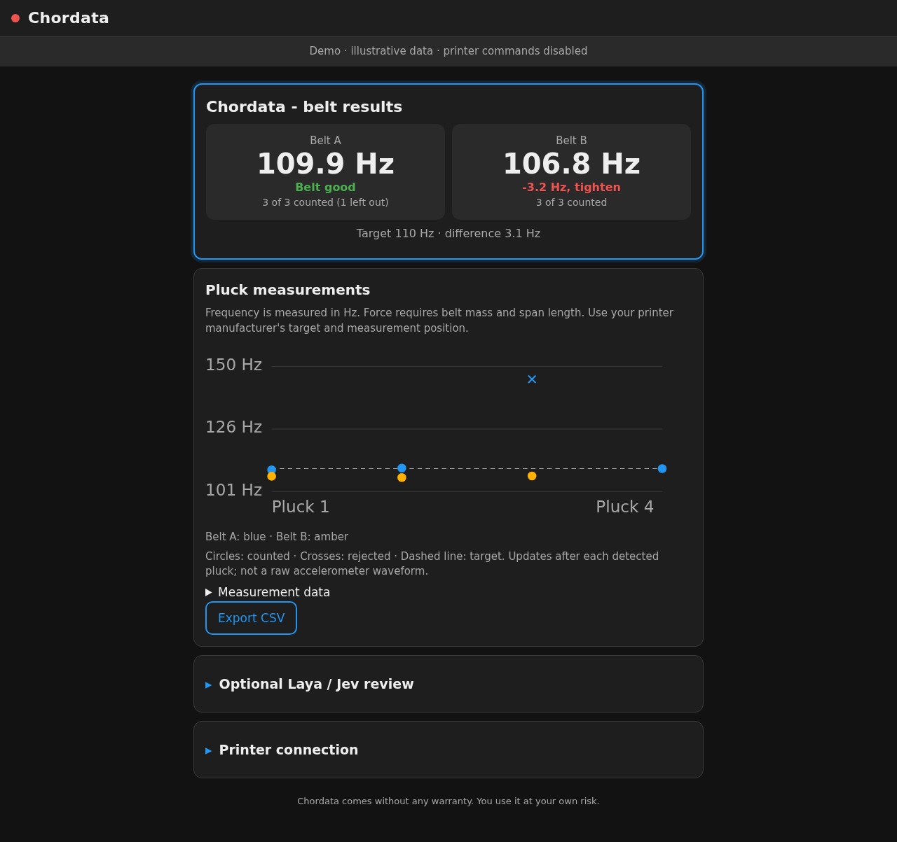

# Chordata

Measure CoreXY belt frequency using the toolhead accelerometer on Klipper or Kalico.
Pluck each belt, inspect the accepted readings, and compare both against the target
specified by your printer manufacturer. Chordata measures frequency in Hz; it does
not measure force or establish a mechanically safe tension.

The live page shows both belts, individual plucks, rejected readings and a target
line. It uses Moonraker subscriptions and updates about once a second while
recording. CSV export includes the latest series for each belt. Raw accelerometer
recordings remain available through Mainsail's config file browser.

Optional Laya or Jev review evaluates measurement quality. It is **off by default**,
asks for your endpoint when enabled, and cannot move the printer, change a target,
or replace the signal-processing result. No AI service is needed to measure belts.



*Illustrative demo data; these readings are not a printer calibration.*

Start with the **[illustrated user guide](docs/USER_GUIDE.md)** for a complete walkthrough,
or the **[troubleshooting guide](docs/TROUBLESHOOTING.md)** if setup or measurement fails.

## Preview without a printer

From this checkout:

```sh
python3 -m http.server 8765 --bind 127.0.0.1 --directory web
```

Open <http://127.0.0.1:8765/?demo>. The page uses illustrative data and disables
printer commands and network connections to Moonraker or an AI service. You can
also open `web/index.html?demo` through a local web server.

## Requirements

- CoreXY printer with Klipper or Kalico, Moonraker and Mainsail or Fluidd.
- Toolhead accelerometer and `[resonance_tester]` configured in Klipper.
- `[respond]` and NumPy installed in Klipper's Python environment.
- Your manufacturer's target frequency, measurement span and toolhead position.

## Install on the printer host

```sh
cd ~
git clone https://github.com/HydrateFrequently/Chordata.git
cd Chordata
./install.sh
sudo systemctl restart moonraker klipper
```

The installer links the Klipper/Kalico modules and Moonraker component, creates
`chordata_settings.cfg` if missing, and adds the macro/settings includes. It preserves
existing settings, backs up printer and Moonraker configuration, and refuses to
replace regular plugin files. It does not restart services itself.

For nonstandard installations, set `KLIPPER_DIR`, `KLIPPY_ENV`, `MOONRAKER_DIR` and
`CONFIG_DIR` before running it. Without Moonraker source available, it installs only
the Klipper macro workflow.

Mainsail's supported [custom navigation](https://github.com/mainsail-crew/docs/blob/zensical/docs/settings/navigation.md)
links to the page at `/server/chordata`. This is a Moonraker companion component,
not a patched Mainsail build. The normal Mainsail reverse proxy must forward
`/server/`, `/access/` and `/websocket` to Moonraker. Fluidd users can open the page
directly. The `CHORDATA` macro also provides the measurement prompts.

The installer adds a Mainsail update-manager entry pointing at this repository.
Existing entries are preserved; see [updating an existing installation](docs/USER_GUIDE.md#update-an-existing-installation)
if your checkout or update-manager entry uses a different remote.

## Measure

1. Finish or cancel any print. Move to the manufacturer's measurement position.
2. Start Chordata and set the target for that belt span. The default 110 Hz is a
   starting value, not a recommendation for every printer.
3. Record a light toolhead tap to learn its resonant frequencies, ring duration and
   line width, or skip this step.
4. Record belt A, then belt B, using even plucks about a second apart. Inspect
   counted and rejected plucks before adjusting anything.
5. Adjust manually using the frequency comparison, then measure **both** belts again.

Completion requires five accepted plucks per belt and an average within the
configured tolerance (default 0.25 Hz). Spread and standard deviation describe
repeatability; they are not calibrated measurement uncertainty. A new attempt
invalidates the previous result for that belt immediately. Recording failures clear
completion rather than leaving a stale success visible.

The direct G-code commands also reject printing, paused printers and concurrent
measurements. Saved-position movement remains an explicit user action. Saved
positions use G-code coordinates; re-save them if you change coordinate offsets.

Settings in `chordata_settings.cfg`:

```ini
[chordata]
belt_target: 110
belt_tolerance: 0.25
```

`CHORDATA_RECORD SECONDS=10 NAME=test` saves a raw CSV; optional `CHIP=` selects an
accelerometer. Recordings are under `chordata/recordings/` in the config directory;
only the latest 40 CSVs are retained. Download important captures before recording more.

## Optional Laya / Jev review

Open **Optional Laya / Jev review** on the page. Enable it, choose the provider,
enter the **full inference URL**, and save. Examples:

| Provider | Endpoint example | Model |
| --- | --- | --- |
| Laya `laya-serve` | `http://laya-host:8000/v1/systemone` | `auto` or a checkpoint your server supports |
| Jev / TypeSafe | `https://api.typesafe.ai/v1/systemone` | `jev-latest` (`auto` maps to this) |

A compatible gateway can use a different URL. Chordata does not append a path or
assume that an arbitrary chat/completions API implements System One. The contract is
`state` plus typed `questions`, returning `answers.review` with a choice, probability
distribution and confidence. See [TypeSafe's HTTP API](https://docs.typesafe.ai/api).

Enter the provider key only in the page's password field. A blank field retains the
key for the same endpoint; changing endpoint/provider clears the old key. The page
also has an explicit clear-key option. Settings are stored with mode `0600` in
Moonraker's data directory as `chordata-ai.json`, outside the downloadable config
root and reserved from file-manager access. Keys are never returned to the browser.
Use HTTPS when credentials cross an untrusted network.

**Review measurements** makes one manual request. It sends only frequency,
target, tolerance, counts, spread, timestamps and standardized rejection reasons.
It sends no raw recordings, printer configuration or file paths. Requests have a
10-second deadline, refuse redirects and validate TLS certificates. An unavailable
service leaves measurement working. Disabling review stops future provider calls.

Review is advisory and experimental. Its confidence is model uncertainty, not sensor
accuracy. The default threshold is 0.7. Low-confidence, malformed, incomplete or
stale reviews are withheld. The live Laya trials for this rewrite abstained; they do
not establish reliable belt-quality classification. Keep the threshold unless you
have validated a different value on your own labelled recordings.

Moonraker protects settings and evaluation with its normal authorization. If your
device is not authenticated, the **Printer connection** section accepts a Moonraker
API key in memory for that page session. It is not stored in browser storage.

## Development and verification

```sh
python3 -m venv .venv
.venv/bin/pip install -r requirements-dev.txt
.venv/bin/python -m unittest discover -s tests -v
.venv/bin/python tests/test_belts.py
npm ci
npx playwright install chromium
npm test
```

The browser suite covers the offline demo, mobile/desktop layout, live updates,
authentication, endpoint settings, CSV export and stale review invalidation. Python
tests cover synthetic signal processing, printer interlocks, capture cleanup,
configuration privacy, provider failures and installer reruns. GitHub Actions runs
these suites on pushes and pull requests. The [validation record](docs/VALIDATION.md)
distinguishes local checks from remote CI and hardware testing.

See [the validation record](docs/VALIDATION.md) for what was actually run and what
still needs testing on a physical printer. Original upstream testing and real-recording
claims are historical; this rewrite has not reproduced them on hardware.

## Origin and license

Chordata started as the belt-tension step of
[Printune](https://github.com/HydrateFrequently/Printune).
GPL-3.0-or-later; see [LICENSE](LICENSE).
