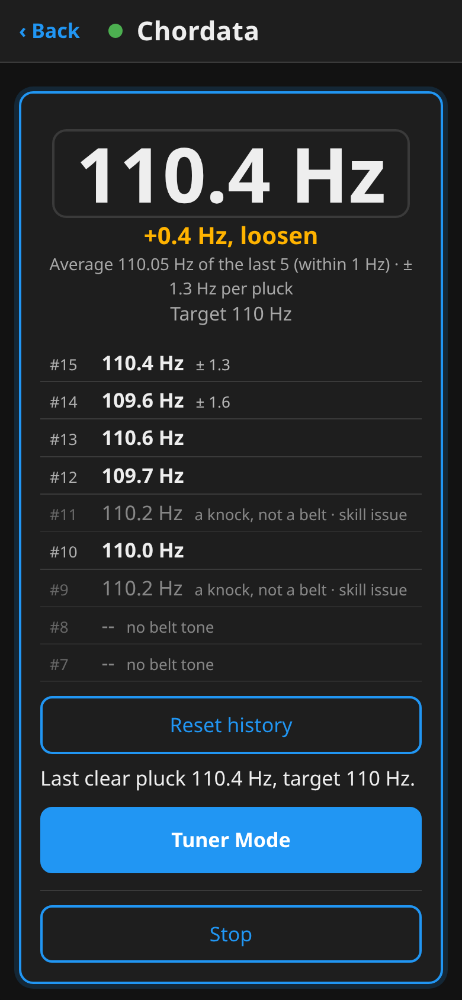
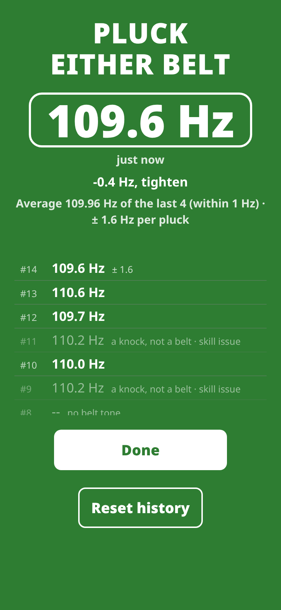
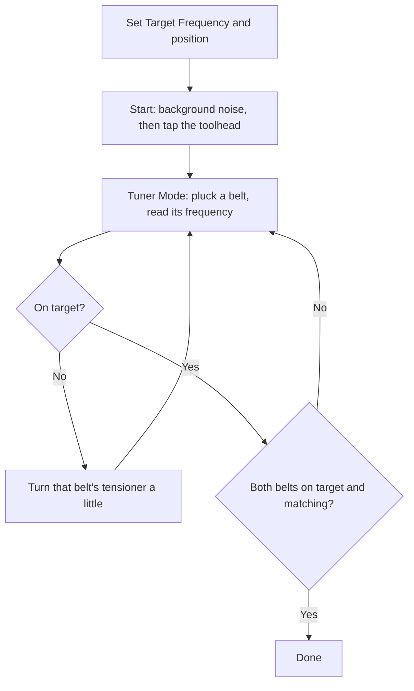

# Chordata user guide

This guide covers [Chordata](https://github.com/HydrateFrequently/Chordata).
It works as a Klipper/Kalico measurement module, a Moonraker companion page, and a
Mainsail sidebar link.

All screenshots below come from a virtual printer (Klipper with a simulated
accelerometer), so their readings are illustrative; the toolhead position, belt span and
target must come from your own printer's documentation. No physical-printer validation is
implied by these images.

## 1. Try the interface first

On a computer with Python 3:

```sh
git clone https://github.com/HydrateFrequently/Chordata.git
cd Chordata
python3 -m http.server 8765 --bind 127.0.0.1 --directory web
```

Open **http://127.0.0.1:8765/?demo** on that computer. Keep `?demo` in the URL:
without it, the page tries to connect to Moonraker on the same host. Demo mode
opens no printer connection and disables printer commands. Stop this preview
server with Ctrl+C when finished. A static preview server does not measure belts.

This is the page after a Tuner Mode session (illustrative data): the last pluck, the average of the last
plucks that agree with its ±, and the session's history.



On a phone, while Chordata listens, the green card shows the same: pluck, read, turn, pluck again.



## 2. Prepare the printer

You need:

- A supported CoreXY configuration running Klipper or Kalico.
- Moonraker and a working Mainsail or Fluidd installation for the page.
- An accelerometer that Klipper can record, mounted on the toolhead.
- A working `[resonance_tester]` configuration and `[respond]` for the prompts.
- NumPy in the Python environment used by Klipper.
- Your manufacturer's measurement position, belt span and target frequency.

Start with a working accelerometer configuration; Chordata does not configure the
sensor's pins, axes or MCU. You can check the existing sensor with Klipper's
`ACCELEROMETER_QUERY` command, using the sensor selection required by your setup.
See the [Klipper resonance measurement instructions](https://www.klipper3d.org/Measuring_Resonances.html)
for sensor installation and checks.

The default target is 110 Hz and the default tolerance is 0.25 Hz. These are software
defaults, not a specification for your printer. Different spans on the same belt can
have different frequencies. Always compare recordings made at the same documented
position and span.

Finish or cancel any print before maintenance. The plugin rejects direct measurement
and saved-position commands while printing, paused, or already recording. Keep the
same sensor mounting and measurement method throughout a comparison.

## 3. Install on the printer host

SSH into the printer's Linux host as its normal user, then run:

```sh
cd ~
git clone https://github.com/HydrateFrequently/Chordata.git
cd Chordata
./install.sh
sudo systemctl restart moonraker klipper
```

Use the actual service names on your host if they differ. For Kalico, the service
may still be named `klipper`; check your installation rather than assuming its name.

The installer:

| Item | Default destination | Behavior |
| --- | --- | --- |
| Measurement modules | `~/klipper/klippy/extras/` or Kalico's `klippy/plugins/` | Symlinks to the checkout |
| Macros | `~/printer_data/config/chordata.cfg` | Symlink to the checkout |
| User settings | `~/printer_data/config/chordata_settings.cfg` | Created only when absent |
| Includes | Top of `printer.cfg` | Adds macros and settings, keeping `SAVE_CONFIG` last |
| Companion component | Moonraker's `moonraker/components/chordata_web.py` | Symlink to the checkout |
| Page configuration | `[chordata_web]` in `moonraker.conf` | Added when absent |
| Mainsail navigation | Config directory's `.theme/navi.json` | Preserves other links |
| Update entry | `[update_manager chordata]` in `moonraker.conf` | Points new installations at this repository |

The initial configuration backups end in `.before-chordata`. The installer refuses
to overwrite a regular plugin file; inspect and back up such files before replacing
them. It validates existing navigation JSON before changing printer configuration.
It never restarts services automatically.

### Nonstandard paths

Set paths explicitly when your installation differs:

```sh
KLIPPER_DIR="$HOME/kalico" \
KLIPPY_ENV="$HOME/klippy-env" \
MOONRAKER_DIR="$HOME/moonraker" \
CONFIG_DIR="$HOME/printer_data/config" \
./install.sh
```

`KLIPPER_DIR` must contain `klippy/`. `MOONRAKER_DIR` must contain
`moonraker/components/`. `CONFIG_DIR` must contain your `printer.cfg`.
If Moonraker source is missing, installation omits the page; the macro workflow
remains available.

If the installer reports missing NumPy, install it into Klipper's own environment,
not just the host's system Python:

```sh
~/klippy-env/bin/python -m pip install numpy
```

### Open the page

Reload Mainsail and select **Chordata** in its sidebar. You can also open:

```text
http://<printer-host>/server/chordata
```

Use your normal printer hostname and HTTPS URL if configured. Fluidd users can use
this direct URL. The same host must proxy `/server/` and `/websocket`
to Moonraker. See [troubleshooting](TROUBLESHOOTING.md) for page or connection errors.

If Moonraker requires authentication, expand **Printer connection**, enter its API
key and select **Authenticate**. This key stays in page memory; reloading forgets
it.

## 4. Set the target and position

Edit `chordata_settings.cfg` in the config file browser:

```ini
[chordata]
# Replace these examples with values appropriate to your printer.
belt_target: 110
belt_tolerance: 0.25
```

Restart Klipper after changing configuration. You can also adjust the session target
in Chordata's initial prompts. A session target does not rewrite the config file.

Use the page's explicit toolhead controls, or Mainsail's own controls, to home and
move to the documented belt-measurement position. Select **Save this position**
(**Save belt tensioning position** in the setup prompt) if you want to reuse it.
**Go to saved position** (**Go to belt tensioning position** in the prompt) is a separate
movement action and requires homing first. It only raises Z when the saved position
requires more clearance; it does not lower Z to the saved value.

Saved positions use G-code coordinates. Re-save after changing coordinate offsets
or the physical measurement setup. Do not copy another printer's saved coordinates.

## 5. Tune both belts



1. Select **Measure Belts** on the page or run `CHORDATA` from the console to open
   **Set Target Frequency**. Type the target and press **Set** (Mainsail's own pop-up has
   -5/-1/+1/+5 buttons instead; Chordata does not choose a manufacturer's target), move the toolhead with the arrows (0.5 to 50 mm steps) or by
   typing X and Y, and save the belt tensioning position. The screen shows the accelerometer
   `[resonance_tester]` uses and the range it hears reliably (for example ADXL345, 0-1440 Hz;
   LIS2DW12, 0-400 Hz); a target outside it is shown in red and can't be started. The instructions and specs are on
   the page's **How it works**.
2. Select **Start**. This switches off the part-cooling fan (the
   macro's `M106 S0`) and goes straight into the taps: keep your hands off while the red card
   records the background noise. This is the only background recording of the session.
   When the card turns yellow, tap one solid spot on the toolhead (the extruder is a good
   one) lightly, one tap at a time. Each tap shows a check mark or an X; keep tapping until
   3 check marks. It stops by itself. A tap counts when it is heard, alone (not a double
   tap) and rings loudest at the same note as the first good tap: another spot rings
   differently. After 9 taps that don't count, Chordata stops and suggests turning off fans
   and anything else that vibrates, and checking that the toolhead is tight. The good taps
   teach Chordata the toolhead's own note, ring time and line width: knocks there are never
   taken for a belt. This step is required: the belts can only be measured once it is done.
   **Measure Toolhead Frequency** repeats it (and records the background again).
3. Select **Tuner Mode**. When the card turns green (the phone beeps, 1000 Hz, 200 ms),
   pluck either belt. Each clear pluck shows its frequency, big, and how far it is from the
   target: tighten or loosen. Turn that belt's tensioner a little and pluck again, until it
   is on target (within the tolerance, 0.25 Hz by default). Then the other belt.
4. Pluck both belts once more: they pull on each other, so turning one moves the other a
   little. You are done when both are on target, and so match each other. Tuner Mode stops
   by itself a minute after the last pluck, or select **Done** on the Chordata page
   (Mainsail's prompt can't end it while it listens); **Tuner Mode** on the next card starts
   it again.

The Chordata page keeps a history of the session's plucks under the number, newest at the
top (the last 100; about 20 show, scroll for more): each pluck's frequency, and the refused
ones greyed with the reason. It carries on across Tuner Mode runs, and is cleared by a new
session (Start), **Close Chordata** and **Reset history** (on the green card and the end
card; it works while Chordata listens). A quick double tap on the toolhead, on the spot you
tapped at the setup (two taps up to 0.8 s apart), does the same as **Reset history**: the whole
history goes, so you can start over without touching the phone; the page says so for a moment,
and the big number stays blank until your next pluck. The double tap itself is
never counted.

Under the number the page shows the **average** of the last plucks that agree (up to 5, all
within 1 Hz of each other, or twice the tolerance if that is wider), so you can pluck and turn on and on. Once four
or more lie together (and are not all exactly alike), it also shows **± Hz per pluck**: how far one reading can be off, at 95 %, judged
from how much those plucks scatter. A real belt's tone varies 0.1-0.4 Hz from pluck to pluck, so
pluck each belt a few times and go by where most land. Chordata doesn't know which belt you
plucked: a pluck of the other belt, or one after a turn of a tensioner, starts a new run only
when it lands more than that apart. Once the belts are nearly matched, plucks of both (and very
small turns) fall in one run, and the ± then holds their difference too.

Fans are told from a belt by how they sound: a pluck or a tap starts its note and dies
away, a fan hums at one level before and after. A fan's hum is left out, whether it was
running when the background was recorded or started later. A belt a few Hz from a fan is
still read. If a fan sits on the belt's note (within about 2 Hz), the green card and the
result say "steady hum at X Hz on the belt's note (a fan?)": turn that fan off and measure
again. The same goes for the toolhead taps: if a fan hides the toolhead's note, Measure
Toolhead Frequency stops after three taps and says "Turn fans off".

Chordata only turns off fans you have allowed. When a fan hums on the belt's note, the card
offers **Allow Chordata to turn off** that fan; once allowed (the choice is kept, also after a
restart) it gets a **Turn off** button there. Fans that cool the hotend, the stepper drivers or
the electronics (heater, controller and temperature fans, and fans named like it) are never
offered. To take an allowance back, run for example `_CHORDATA_FAN_OK SECTION="fan_generic aux_fan" ALLOW=0`
(the fan's section name in printer.cfg; `SECTION=fan` for the part cooling fan), or delete
`chordata/fans_ok.json` in the config folder to take all of them back.

Cards never need a press on the phone (only Tuner Mode has a Done button): red means hands off, yellow means tap the
toolhead, green means pluck, and each stays until that step is over.

If a pluck is weak or left out, pluck again rather than striking much harder. Pluck
evenly, the same way each time. On the Chordata page the number is the newest clear
pluck; a number still settling is shown dimmed, and its age ("3 s ago") says when it was heard.
The box around the number lights up for a moment each time a pluck is heard (and the phone
vibrates briefly); nothing else on the screen flashes.

Closing a prompt or selecting **Stop** ends the prompt workflow; it is not an
immediate cancellation of an active G-code recording. Wait until Chordata is idle
before starting another measurement.

## 6. Recordings

Raw recordings appear under `chordata/recordings/` in the config file browser.
Each Tuner Mode run is one file (`free-*.csv`); the taps and the session's background
capture (saved with the taps) have their own names. Chordata retains the
latest 40 CSV files; save important captures elsewhere before continuing.

For a standalone capture:

```gcode
CHORDATA_RECORD SECONDS=10 NAME=reference
```

To select a named sensor, use the name supported by your Klipper configuration:

```gcode
CHORDATA_RECORD CHIP=hotend SECONDS=10 NAME=reference
```

Here `hotend` is an example sensor name, not a required name. Supported recording
duration is 0.5–30 seconds. The CSV contains time and X/Y/Z acceleration samples.

## 7. Updates and migration

Before updating, finish maintenance and preserve any local code changes. For a clean
checkout of this repository:

```sh
cd ~/Chordata
git pull --ff-only
./install.sh
sudo systemctl restart moonraker klipper
```

Mainsail's update manager can use the generated `[update_manager chordata]` entry.
The installer's symlinks keep modules connected to the checkout, so restart Klipper
and Moonraker after changing Python modules. Reload the browser for page changes.

### Update an existing installation

For an existing clean checkout, inspect the remote and pull its configured branch:

```sh
cd ~/Chordata
git status --short
git remote -v
git pull --ff-only
./install.sh
```

Preserve local changes before updating. Do not force a failed fast-forward. Check
that the tracked branch and Moonraker update entry point at the repository you want
to follow. If you use a fork, keep its remote and branch instead of mixing sources.

The installer keeps an existing Moonraker update entry, except that it sets
`primary_branch` to the branch checked out in the Chordata folder. An upstream
installation can use:

```ini
[update_manager chordata]
type: git_repo
path: ~/Chordata
origin: https://github.com/HydrateFrequently/Chordata.git
primary_branch: main
managed_services: klipper moonraker
```

Keep your actual path and managed service names, then restart Moonraker and Klipper.
The user settings file and saved recordings remain in the printer config directory.

### Remove Chordata

```sh
~/Chordata/uninstall.sh
sudo systemctl restart moonraker klipper
rm -rf ~/Chordata
```

`uninstall.sh` does the steps below and backs up each file it changes
(`*.before-chordata-uninstall`). By hand: remove its two include lines from `printer.cfg`, `[chordata_web]` and its update
entry from `moonraker.conf`, and the Chordata item from `.theme/navi.json`. Remove
only the Chordata symlinks installed in Klipper/Kalico, Moonraker and the config
directory after confirming their targets. Restart the affected services. Preserve
`chordata_settings.cfg` and `chordata/` if you want the saved settings and recordings.
Do not restore an old whole-file backup over unrelated newer settings.

## Further reference

- [Troubleshooting](TROUBLESHOOTING.md)
- [Klipper measuring resonances](https://www.klipper3d.org/Measuring_Resonances.html)
- [Moonraker API documentation](https://moonraker.readthedocs.io/en/latest/external_api/introduction/)

To reproduce the screenshots after changing the interface:

```sh
npm ci
npx playwright install chromium
node tools/capture-docs.cjs
```

The screenshot tool renders the offline demo with illustrative settings (the images in this
guide were taken on a virtual printer instead).
