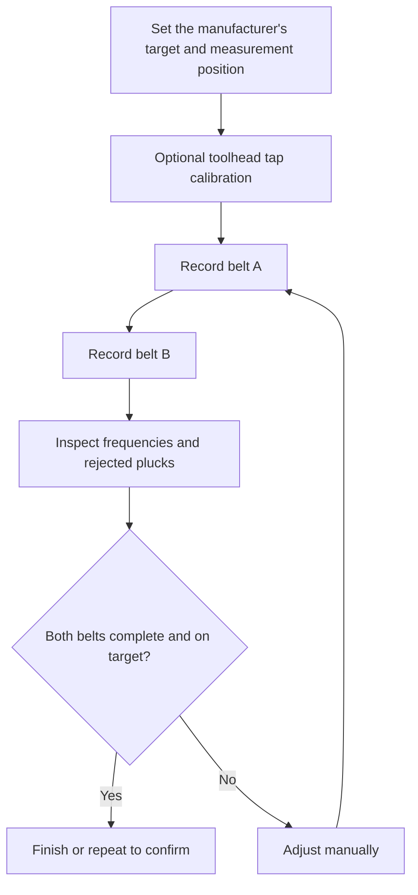

# Chordata user guide

This guide covers [Chordata](https://github.com/HydrateFrequently/Chordata).
It works as a Klipper/Kalico measurement module, a Moonraker companion page, and a
Mainsail sidebar link.

All screenshots below come from the shipped offline demo. Their readings are
illustrative; the toolhead position, belt span and target must come from your own
printer's documentation. No physical-printer validation is implied by these images.

## 1. Try the interface first

On a computer with Python 3:

```sh
git clone https://github.com/HydrateFrequently/Chordata.git
cd Chordata
python3 -m http.server 8765 --bind 127.0.0.1 --directory web
```

Open **http://127.0.0.1:8765/?demo** on that computer. Keep `?demo` in the URL:
without it, the page tries to connect to Moonraker on the same host. Demo mode
opens no printer connection and disables printer commands. Stop this preview
server with Ctrl+C when finished. A static preview server does not measure belts.


For a narrow screen, the same interface stacks its controls and preserves the data:


## 2. Prepare the printer

You need:

- A supported CoreXY configuration running Klipper or Kalico.
- Moonraker and a working Mainsail or Fluidd installation for the page.
- An accelerometer that Klipper can record, mounted on the toolhead.
- A working `[resonance_tester]` configuration and `[respond]` for the prompts.
- NumPy in the Python environment used by Klipper.
- Your manufacturer's measurement position, belt span and target frequency.

Start with a working accelerometer configuration; Chordata does not configure the
sensor's pins, axes or MCU. You can check the existing sensor with Klipper's
`ACCELEROMETER_QUERY` command, using the sensor selection required by your setup.
See the [Klipper resonance measurement instructions](https://www.klipper3d.org/Measuring_Resonances.html)
for sensor installation and checks.

The default target is 110 Hz and the default tolerance is 0.25 Hz. These are software
defaults, not a specification for your printer. Different spans on the same belt can
have different frequencies. Always compare recordings made at the same documented
position and span.

Finish or cancel any print before maintenance. The plugin rejects direct measurement
and saved-position commands while printing, paused, or already recording. Keep the
same sensor mounting and measurement method throughout a comparison.

## 3. Install on the printer host

SSH into the printer's Linux host as its normal user, then run:

```sh
cd ~
git clone https://github.com/HydrateFrequently/Chordata.git
cd Chordata
./install.sh
sudo systemctl restart moonraker klipper
```

Use the actual service names on your host if they differ. For Kalico, the service
may still be named `klipper`; check your installation rather than assuming its name.

The installer:

| Item | Default destination | Behavior |
| --- | --- | --- |
| Measurement modules | `~/klipper/klippy/extras/` or Kalico's `klippy/plugins/` | Symlinks to the checkout |
| Macros | `~/printer_data/config/chordata.cfg` | Symlink to the checkout |
| User settings | `~/printer_data/config/chordata_settings.cfg` | Created only when absent |
| Includes | Top of `printer.cfg` | Adds macros and settings, keeping `SAVE_CONFIG` last |
| Companion component | Moonraker's `moonraker/components/chordata_web.py` | Symlink to the checkout |
| Page configuration | `[chordata_web]` in `moonraker.conf` | Added when absent |
| Mainsail navigation | Config directory's `.theme/navi.json` | Preserves other links |
| Update entry | `[update_manager chordata]` in `moonraker.conf` | Points new installations at this repository |

The initial configuration backups end in `.before-chordata`. The installer refuses
to overwrite a regular plugin file; inspect and back up such files before replacing
them. It validates existing navigation JSON before changing printer configuration.
It never restarts services automatically.

### Nonstandard paths

Set paths explicitly when your installation differs:

```sh
KLIPPER_DIR="$HOME/kalico" \
KLIPPY_ENV="$HOME/klippy-env" \
MOONRAKER_DIR="$HOME/moonraker" \
CONFIG_DIR="$HOME/printer_data/config" \
./install.sh
```

`KLIPPER_DIR` must contain `klippy/`. `MOONRAKER_DIR` must contain
`moonraker/components/`. `CONFIG_DIR` must contain your `printer.cfg`.
If Moonraker source is missing, installation omits the page; the macro workflow
remains available.

If the installer reports missing NumPy, install it into Klipper's own environment,
not just the host's system Python:

```sh
~/klippy-env/bin/python -m pip install numpy
```

### Open the page

Reload Mainsail and select **Chordata** in its sidebar. You can also open:

```text
http://<printer-host>/server/chordata
```

Use your normal printer hostname and HTTPS URL if configured. Fluidd users can use
this direct URL. The same host must proxy `/server/` and `/websocket`
to Moonraker. See [troubleshooting](TROUBLESHOOTING.md) for page or connection errors.

If Moonraker requires authentication, expand **Printer connection**, enter its API
key and select **Authenticate**. This key stays in page memory; reloading forgets
it.

## 4. Set the target and position

Edit `chordata_settings.cfg` in the config file browser:

```ini
[chordata]
# Replace these examples with values appropriate to your printer.
belt_target: 110
belt_tolerance: 0.25
```

Restart Klipper after changing configuration. You can also adjust the session target
in Chordata's initial prompts. A session target does not rewrite the config file.

Use the page's explicit toolhead controls, or Mainsail's own controls, to home and
move to the documented belt-measurement position. Select **Save belt tensioning
position** if you want to reuse it. **Go to belt tensioning position** is a separate
movement action and requires homing first. It only raises Z when the saved position
requires more clearance; it does not lower Z to the saved value.

Saved positions use G-code coordinates. Re-save after changing coordinate offsets
or the physical measurement setup. Do not copy another printer's saved coordinates.

## 5. Record both belts



1. Select **Belt tension** on the page or run `CHORDATA` from the console to open
   setup. Select **Start** in that prompt when ready; this also switches off the
   part-cooling fan through the macro's `M106 S0` command.
2. Confirm the target and position. Chordata does not choose a manufacturer's target.
3. If using tap calibration, select **Listen for the tap**, keep your hands off while
   background noise is recorded, then lightly tap the toolhead when prompted. This
   identifies toolhead frequencies, ring duration and line width to help distinguish
   a knock from a belt. The learned width sets a per-mode guard; long-ringing
   toolheads also use onset detection outside those modes. You may skip this step.
4. Select **Listen to belt A**. Wait through the initial background recording, then
   pluck the documented belt span evenly, about once a second.
5. Inspect the counted and rejected plucks. When recording finishes, continue to B.
6. Repeat for **belt B**, using the same measurement method and position.
7. Read the comparison. If you adjust either tensioner, measure **both** belts again:
   the belts interact mechanically.

A recording can continue for a bounded extra interval to collect enough accepted
plucks. If a pluck is weak or rejected, wait for the prompt and pluck again rather
than striking much harder. Do not adjust a tensioner while a series is recording.

Closing a prompt or selecting **Stop** ends the prompt workflow; it is not an
immediate cancellation of an active G-code recording. Wait until Chordata is idle
before starting another measurement or adjusting the belts.

## 6. Read the chart and measurement data


| Display | Meaning |
| --- | --- |
| Belt A / Belt B large number | Average accepted frequency for that series, in Hz |
| Counted plucks | Readings accepted by the deterministic signal analysis |
| Rejected plucks | Attempts excluded from the average; the table supplies the reason |
| Blue / amber | Belt A / belt B |
| Circle / cross | Counted / rejected point with a detected frequency |
| Dashed line | Current target frequency |
| Missing frequency | No reliable tone was detected; the rejected row remains in the table |
| Difference | Frequency difference between the two belt averages |

The live chart updates from detected plucks about once a second. It shows frequency
by pluck number, not a continuous accelerometer waveform. A rejected point can
stretch the chart scale; use the table for exact values.

Completion requires five accepted plucks on each belt and an average within the
configured tolerance. A partial series can show an average while still needing more
readings. Spread and standard deviation in the result data describe repeatability;
they do not establish sensor accuracy. The UI measures frequency, not force.

Starting a new attempt clears the previous result for that belt. Failed recordings
clear completion. Prior readings for the other belt can remain visible while you
measure the current belt; complete a fresh pair after adjustments.

### Export and recordings

Select **Measurement data** to expand the table, then **Export CSV** to download
the latest displayed A/B series. Columns are `belt`, `pluck`, `frequency_hz`,
`accepted` and `reason`. The live current series replaces that belt's previous series.
This export is a frequency summary, not raw accelerometer samples.

Raw recordings appear under `chordata/recordings/` in the config file browser.
Belt captures and background captures have separate names. Chordata retains the
latest 40 CSV files; save important captures elsewhere before continuing.

For a standalone capture:

```gcode
CHORDATA_RECORD SECONDS=10 NAME=reference
```

To select a named sensor, use the name supported by your Klipper configuration:

```gcode
CHORDATA_RECORD CHIP=hotend SECONDS=10 NAME=reference
```

Here `hotend` is an example sensor name, not a required name. Supported recording
duration is 0.5–30 seconds. The CSV contains time and X/Y/Z acceleration samples.

## 7. Updates and migration

Before updating, finish maintenance and preserve any local code changes. For a clean
checkout of this repository:

```sh
cd ~/Chordata
git pull --ff-only
./install.sh
sudo systemctl restart moonraker klipper
```

Mainsail's update manager can use the generated `[update_manager chordata]` entry.
The installer's symlinks keep modules connected to the checkout, so restart Klipper
and Moonraker after changing Python modules. Reload the browser for page changes.

### Update an existing installation

For an existing clean checkout, inspect the remote and pull its configured branch:

```sh
cd ~/Chordata
git status --short
git remote -v
git pull --ff-only
./install.sh
```

Preserve local changes before updating. Do not force a failed fast-forward. Check
that the tracked branch and Moonraker update entry point at the repository you want
to follow. If you use a fork, keep its remote and branch instead of mixing sources.

Existing Moonraker update entries are preserved by the installer. An upstream
installation can use:

```ini
[update_manager chordata]
type: git_repo
path: ~/Chordata
origin: https://github.com/HydrateFrequently/Chordata.git
primary_branch: main
managed_services: klipper moonraker
```

Keep your actual path and managed service names, then restart Moonraker and Klipper.
The user settings file and saved recordings remain in the printer config directory.

### Remove Chordata

Remove its two include lines from `printer.cfg`, `[chordata_web]` and its update
entry from `moonraker.conf`, and the Chordata item from `.theme/navi.json`. Remove
only the Chordata symlinks installed in Klipper/Kalico, Moonraker and the config
directory after confirming their targets. Restart the affected services. Preserve
`chordata_settings.cfg` and `chordata/` if you want the saved settings and recordings.
Do not restore an old whole-file backup over unrelated newer settings.

## Further reference

- [Troubleshooting](TROUBLESHOOTING.md)
- [Klipper measuring resonances](https://www.klipper3d.org/Measuring_Resonances.html)
- [Moonraker API documentation](https://moonraker.readthedocs.io/en/latest/external_api/introduction/)

To reproduce the screenshots after changing the interface:

```sh
npm ci
npx playwright install chromium
node tools/capture-docs.cjs
```

The screenshot tool uses only the offline demo and illustrative settings.
